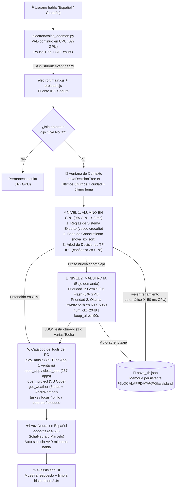

# 🧠 Arquitectura de GlassIsland & N.O.V.A.

> **N.O.V.A.** (*Núcleo Operativo Virtual de Asistencia*) es un asistente de escritorio para Windows 10/11 integrado en **GlassIsland**, diseñado con una arquitectura híbrida **Maestro → Alumno** para ofrecer respuestas instantáneas (`< 5 ms`, `0% GPU`) en el uso diario y máxima inteligencia conversacional con **Ollama (`Qwen2.5-7B`)** en tu GPU NVIDIA RTX 5050 o **Gemini API**.

---

## 1. Diagrama completo del sistema

---

## 2. Cómo funciona cada capa (paso a paso)

### A. Captura de voz sin cortes (`electron/voice_daemon.py`)
- Corre en un proceso Python liviano en **CPU (`0% GPU`)**.
- Calibra automáticamente el ruido ambiental al iniciar (`0.6 s`) y usa **VAD adaptativo** con ventana de silencio de **`1.5 s`** para que puedas pausar a pensar una canción o comando sin que se corte.
- Mientras **Nova** habla su respuesta, el micrófono se auto-silencia el tiempo exacto de duración del audio MP3 para nunca escucharse a sí misma.

### B. Ventana de Contexto (`ui/src/utils/novaDecisionTree.ts`)
- Mantiene en memoria los **últimos 8 turnos de conversación** (`role`, `text`, `intent`, `at`) junto con `lastIntent`, `lastEntity` y `lastCity` (`Santa Cruz de la Sierra, Bolivia`).
- Permite conversaciones naturales de seguimiento:
  - Tú: *"Oye Nova, ¿a cuántos grados estamos hoy?"* → Guarda `lastIntent = "weather"`.
  - Tú: *"¿Y mañana?"* o *"Ábrelo en AccuWeather"* → El contexto conecta automáticamente la frase corta con el clima sin tener que repetir toda la pregunta.
- Cuando se consulta al Maestro (`Ollama` o `Gemini`), ese historial reciente se envía dentro del contexto para mantener coherencia conversacional.

### C. Nivel 1 — El Alumno en CPU (`0% GPU`, `< 2 ms`)
Antes de tocar tu tarjeta gráfica, **Nova** pasa la orden por tres filtros ultrarrápidos:
1. **Sistema Experto lingüístico** (`ui/src/utils/subuCommands.ts`): entiende español natural y voseo de Santa Cruz, Bolivia (*abrime, poneme, decime, subile, bajale, mermale, cerrame, anotame, che Nova*).
2. **Memoria Exacta y Difusa (`nova_kb.json`)**: busca alias personales (*"recuerda que mi editor es VS Code"*) y frases previamente aprendidas con similitud de tokens $\ge 0.80$.
3. **Árbol de Decisiones / Clasificador TF-IDF en CPU** (`novaDecisionTree.ts`): puntúa la intención combinando los ejemplos base + tus ejemplos reales enseñados. Si la confianza es $\ge 0.78$, ejecuta directo en CPU sin despertar la GPU.

### D. Nivel 2 — El Maestro IA (`Ollama RTX 5050` / `Gemini`) + Destilación
Si dices una frase compleja o totalmente nueva (por ejemplo: *"Oye Nova, cambia la música por Firestone, bájame el brillo al 60 y ponme 25 minutos de Focus"*):
1. **Nova** llama al Maestro (`Gemini 2.5 Flash` si hay API Key, o **`Ollama qwen2.5:7b`** en `http://127.0.0.1:11434`).
2. Ollama está configurado con:
   - `num_ctx: 2048` → corre **100% en tu RTX 5050 8 GB** (~5.1 GB VRAM, `< 1 s` de respuesta).
   - `keep_alive: "90s"` → tras 90 segundos sin uso, Ollama descarga el modelo automáticamente y devuelve el **100% de la VRAM** a tu laptop.
3. El Maestro devuelve un JSON con las **Tools** a ejecutar, Nova las corre en secuencia y **guarda el nuevo patrón en `nova_kb.json`**, re-entrenando el Árbol de Decisiones en CPU en `< 50 ms`.

### E. Cómo hacer Fine-Tuning futuro con tus propios datos
Cada frase que enseñas en 1 clic o que resuelve el Maestro queda guardada en:
`%LOCALAPPDATA%\GlassIsland\nova_kb.json`

Cuando acumules **150–300 frases reales tuyas**, puedes entrenar un adaptador **LoRA (QLoRA 4-bit)** con **Unsloth** sobre **`Qwen2.5-3B-Instruct`** o **`Qwen2.5-7B-Instruct`** en tu propia RTX 5050, exportarlo a `.gguf` y cargarlo en Ollama como tu propio modelo personalizado (`ollama create nova -f Modelfile`).

---

## 3. Stack Tecnológico

| Capa | Tecnología | Rol |
| :--- | :--- | :--- |
| **Escritorio / Ventana** | Electron (frameless transparent + click-through) | Isla flotante siempre visible sin bordes ni fondo gris |
| **Interfaz** | React 19 + TypeScript + Vite + Canvas Liquid Glass | Animaciones spring, tema *Liquid Glass* y *Frutiger Aero* |
| **Puente Windows** | PowerShell persistente (`win_bridge.ps1`) + WinRT GSMTC + WMI | Control real de música (YouTube/Spotify/Edge), brillo `< 15 ms`, telemetría |
| **Voz (STT + TTS)** | Python `.venv` (`sounddevice`, `SpeechRecognition`, `edge-tts`) | Escucha continua VAD + voz neural fluida `es-BO` |
| **Cerebro Híbrido** | Árbol de Decisiones CPU + `nova_kb.json` + Ollama (`qwen2.5:7b`) + Gemini | 0% GPU en comandos conocidos + IA completa bajo demanda |
