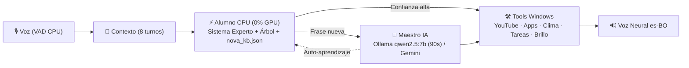

<div align="center">

# 🏝️ GlassIsland + N.O.V.A.

**Dynamic Island interactiva para Windows 10/11 con Liquid Glass, Frutiger Aero y Asistente de Voz IA Híbrido (CPU + Ollama GPU / Gemini)**

[](https://github.com/hebertsb/glass-island)
[](https://www.electronjs.org/)
[](https://react.dev/)
[](https://ollama.com/)

[✨ Probar Demo Interactiva Online](https://hebertsb.github.io/glass-island/) · [🧠 Ver Arquitectura de N.O.V.A.](./ARQUITECTURA_NOVA.md)

</div>

---

## 🚀 ¿Qué es GlassIsland?

**GlassIsland** es una **Isla Dinámica** nativa para Windows diseñada para productividad diaria y desarrollo de software. Vive discretamente en el borde superior de tu pantalla con ojitos expresivos animados, se expande suavemente al acercar el cursor o al llamarla por voz (**"Oye Nova..."**), y unifica música en vivo, Pomodoro Focus, telemetría de laptop, apps oficiales instaladas y un asistente de voz inteligente que **aprende de tu forma de hablar**.

### ✨ Características principales

- **🎨 Motor visual dual**: **Liquid Glass** adaptativo (cambia de color según el módulo o el color dominante del ícono de cada app) + modo **💧 Frutiger Aero** luminoso.
- **🎙️ N.O.V.A. — Asistente de voz manos libres en español**:
  - Escucha continua real sin presionar botones (*"Oye Nova..."*, *"Hey Nova..."*, *"Che Nova..."*).
  - Voz neural fluida en español latino (`edge-tts`: *Sofía · Bolivia*, *Marcelo · Bolivia*, *Dalia · México*, *Jorge · México*).
  - **Reproducción directa en 1 sola ventana**: reproduce canciones al instante en tu app de escritorio de **YouTube** (reemplazando la canción anterior sin duplicar ventanas y saltando Shorts).
- **🧠 Cerebro Híbrido Maestro → Alumno (`0% GPU` en reposo)**:
  - **Alumno en CPU (`< 2 ms`)**: Sistema Experto + Ventana de Contexto (8 turnos) + Base de Conocimiento (`nova_kb.json`) + Árbol de Decisiones TF-IDF que aprende con 1 clic o por voz.
  - **Maestro IA bajo demanda**: se conecta a **Ollama local (`qwen2.5:7b` con `keep_alive: 90s` y `num_ctx: 2048`)** en GPU NVIDIA o a **Gemini 2.5 Flash**, resolviendo órdenes complejas y enseñándoselas al Alumno.
- **📱 Integración con apps reales de Windows (260+ detectadas)**:
  - Detecta todas tus apps del Menú Inicio (`.exe`, `.lnk`, MSIX/Store), extrae su ícono oficial y color de marca, muestra RAM/uptime en vivo y ofrece prompt rápido para agentes IA (*Claude, Copilot, Antigravity, Codex*).
- **🏠 Home Panorámico Drag & Drop**:
  - 2 a 5 tarjetas reordenables arrastrando en vivo: **Laptop (CPU/RAM/Batería/Disco)**, **Música GSMTC (YouTube/Spotify/Chrome/Edge)**, **Focus Pomodoro**, **Clima de 3 días**, **Tareas**, **Estante de Archivos** y **Portapapeles**.
- **⚙️ Ajustes modernos sin scroll**:
  - Panel por pestañas horizontales (`Nova & IA`, `Diseño`, `Apps`, `Home`, `Accesos`, `Dock`) con switches animados estilo iOS/macOS.

---

## 🧠 Arquitectura (Resumen)



> Consulta la documentación técnica completa en [ARQUITECTURA_NOVA.md](./ARQUITECTURA_NOVA.md).

---

## 🛠️ Instalación y ejecución local

### Requisitos
- Windows 10 / 11
- Node.js 18+
- Python 3.10+
- *(Opcional para IA 100% offline)* [Ollama](https://ollama.com/download/windows) con `qwen2.5:7b`

### 1. Clonar e instalar dependencias
```powershell
git clone https://github.com/hebertsb/glass-island.git
cd glass-island

# Dependencias de Electron y Frontend React
npm install
npm --prefix ui install
npm --prefix ui run build

# Entorno Python para micrófono continuo y voz neural
python -m venv .venv
.\.venv\Scripts\pip install SpeechRecognition sounddevice numpy edge-tts
```

### 2. (Opcional) Activar cerebro local en GPU con Ollama
```powershell
ollama pull qwen2.5:7b
```
Luego abre **`+` → `🎙️ Nova & IA`** dentro de GlassIsland y escribe `qwen2.5:7b` en el campo de Ollama (o pega tu API Key gratuita de Google AI Studio).

### 3. Iniciar GlassIsland
```powershell
npx electron .
```

---

## 💬 Ejemplos de comandos de voz

| Categoría | Ejemplos naturales |
| :--- | :--- |
| **Música directa** | *"Oye Nova, poneme Firestone en YouTube"* · *"Cambia la canción por La Macarena"* · *"Subile el volumen"* |
| **Programación** | *"Oye Nova, abrime VS Code"* · *"Abrime el proyecto discoclaro"* · *"Cierra YouTube"* |
| **Clima y contexto** | *"¿A cuántos grados estamos hoy?"* → *"¿Y mañana?"* → *"Ábrelo en AccuWeather"* |
| **Productividad** | *"¿Qué tareas tengo para hoy?"* · *"Anótame una tarea: terminar el diagrama"* · *"Pon Focus 25 minutos"* |
| **Sistema** | *"Toma una captura de pantalla"* · *"Baja el brillo al 60"* · *"Cambia a Frutiger Aero"* |
| **Aprendizaje** | *"Nova, recuerda que mi editor es Visual Studio Code"* |

---

## 📂 Estructura del proyecto

```text
glass-island/
├── electron/
│   ├── main.cjs           # Proceso principal Electron, IPC, YouTube switcher, Ollama/Gemini router
│   ├── preload.cjs        # Bridge seguro contextIsolation
│   ├── win_bridge.ps1     # Worker persistente WinRT GSMTC + WMI brillo
│   └── voice_daemon.py    # Demonio VAD en CPU + síntesis neural edge-tts
├── ui/                    # Frontend React 19 + TypeScript + Vite
│   └── src/
│       ├── App.tsx
│       ├── engine/LiquidGlass.tsx
│       ├── components/RobotFace.tsx
│       └── utils/
│           ├── subuCommands.ts      # Motor de Tools + Base de Conocimiento
│           └── novaDecisionTree.ts  # Ventana de contexto + Árbol de Decisiones en CPU
├── docs/
│   └── index.html         # Demo interactiva lista para GitHub Pages
├── ARQUITECTURA_NOVA.md   # Documentación técnica profunda
└── README.md
```

---

## 👤 Autor

Desarrollado por **Hebert Suárez Burgos** ([@hebertsb](https://github.com/hebertsb)) — Santa Cruz de la Sierra, Bolivia.
